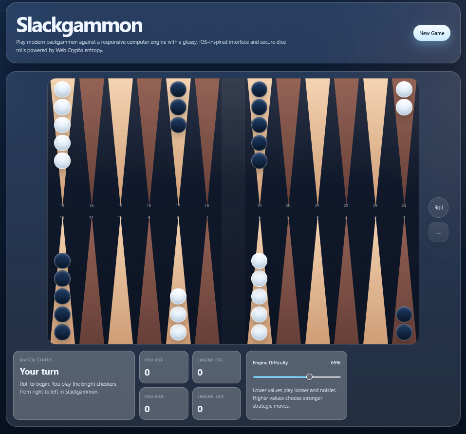

# Slackgammon

Slackgammon is a sleek progressive web app for playing backgammon against a built-in computer engine. It uses a glassy, iOS-inspired interface, supports offline installation as a PWA, and rolls dice with browser cryptographic randomness via `crypto.getRandomValues()`.

## Features

- Playable backgammon board with hits, bar entry, and bearing off
- Adjustable engine difficulty slider
- Right-side roll control and live dice display
- Installable PWA with manifest and service worker
- Lightweight local server with no external dependencies

## Run Locally

1. Install Node.js if it is not already available.
2. From the project folder, run:

```bash
npm start
```

3. Open `http://localhost:4173`.

## Scripts

- `npm start` runs the local static server
- `npm run check` performs a syntax check on the main JavaScript files

## How To Play

- You control the light checkers and move from right to left.
- Click `Roll` to begin your turn.
- Select a highlighted checker, then click a highlighted destination.
- If one of your checkers is on the bar, it must re-enter before any other move.
- Once all of your checkers are in your home board, you can bear them off.
- If a roll cannot produce a legal move, the turn passes automatically.

## Notes

- Dice rolls use Web Crypto in supported browsers. In environments without it, the app falls back to `Math.random()`.
- The app is implemented as a static site, so it can be hosted easily on most web servers or deployed as-is to static hosting.
